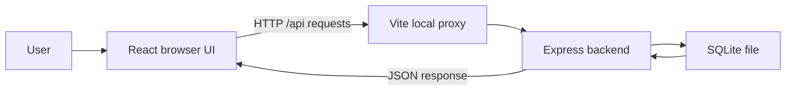
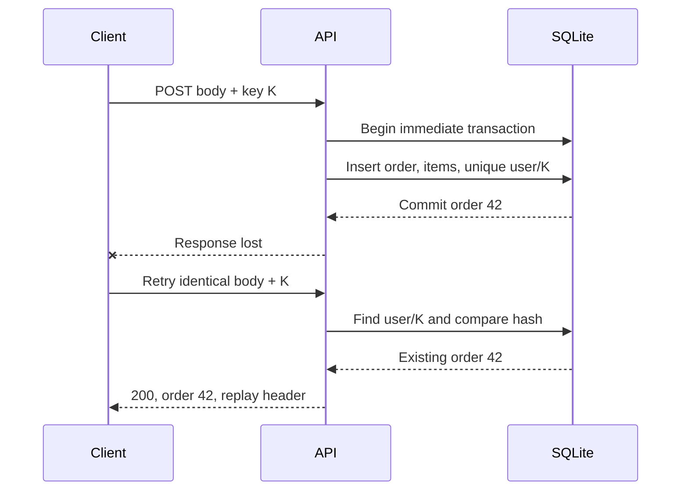

# Understanding and modifying SARH Orders Console

This guide assumes you know variables, functions, conditions and loops. It explains the actual application, not an imaginary architecture. Paths are relative to the repository root. Examples marked **exercise** are proposed changes, not implemented features. Start with README to run the application. This is a code-learning guide; a separate interview preparation guide is outside this document.

## Reading route

1. Read sections 1–4 for the system and language basics.
2. Follow the list request in sections 5–6.
3. Study order creation, money and idempotency in sections 7–9.
4. Read authentication and the database in sections 10–11.
5. Use the file map and change recipes in sections 12–14 while editing.
6. Use the test and troubleshooting sections before considering a change finished.

## 1. What runs where?

The **frontend** runs in the browser and draws forms and tables. The **backend** runs in Node and decides which operations are allowed. SQLite stores data in a real file. Closing the browser does not delete orders.



In development, Vite listens on 5173 and the API on 4000. The browser sends `/api/orders` to its own origin. Vite forwards it to the backend, so browser code does not hardcode the backend port. An **origin** means protocol, host and port together. This same-origin proxy also simplifies cookie handling.

`server/src/index.ts` starts the server. `server/src/app.ts` builds the Express application. Separating them lets tests create an application without starting the normal port or opening the user's database.

`client/index.html` contains the root element. `client/src/main.tsx` mounts React into it, loads CSS and enables StrictMode. `App.tsx` chooses loading, login or orders based on the current session. There is no page-router library; the application has a small conditional screen flow.

`npm run dev` starts both development processes. `npm run build` creates JavaScript/CSS output in the two `dist` folders. `npm start` starts only the compiled API. It does not host the frontend; README explains local Vite preview separately.

## 2. TypeScript and React concepts used here

| Syntax/concept | Meaning | Example in this project |
|---|---|---|
| `interface` | Describes an object's expected shape | `User`, `OrderSummary`, `CreateOrderBody` in `client/src/types.ts` |
| Union type | One of several alternatives | `'admin' \| 'agent'` |
| `unknown` | A value whose type has not yet been checked | Parsed external JSON before validation |
| Type guard | Checks a value and narrows its type | `isRecord` in `guards.ts` |
| `import type` | Imports compile-time types, not runtime code | Shared types within each project layer |
| `async` / `await` | Waits for a Promise while allowing other work | `fetch`, bcrypt password comparison |
| `try/catch` | Turns failures into controlled behavior | Login route passes failures to `next(error)` |
| `.map()` | Produces one result per element | Render order rows or validate each item |
| `.reduce()` | Combines elements into one value | Sum item totals |
| `?.` | Access only when the value is present | Optional cancellation signal |
| `??` | Supply a fallback for null/undefined | Default API target or page size |

TypeScript checks source code before it runs. It cannot stop a malicious HTTP client from sending `quantity: "hello"`. That is why runtime validation is still necessary.

A React **component** is a function that returns UI. **Props** are its inputs. **State** is remembered data whose changes trigger rendering. **JSX** is the HTML-like syntax in `.tsx` files; it can include JavaScript expressions in braces.

The project uses these hooks:

- `useState`: values that affect the UI, such as filters and errors.
- `useRef`: persistent mutable values that do not trigger rendering, such as a request counter or immediate submit lock.
- `useEffect`: synchronize with external work after rendering, and return cleanup for cancellation.
- `useLayoutEffect`: runs before paint; used to invalidate obsolete list work without briefly showing the wrong rows.
- `useCallback` / `useMemo`: retain function/object identity when dependencies have not changed. They are not correctness guarantees by themselves.
- `useContext`: obtain the shared authentication state without passing it through every component.
- `useId`: connect labels to inputs with unique identifiers.

A hook is a function beginning with `use` that follows React's hook rules. Call hooks at the top level, not inside arbitrary conditions or loops. Dependency arrays determine when effects or memoized values update. Omitting a dependency can leave a callback reading old values, called a **stale closure**.

React may run effect setup/cleanup extra times in development StrictMode. Seeing an aborted request during initial development rendering does not automatically mean a production error. Cleanup must remain correct.

## 3. HTTP, JSON and the API contract

An HTTP request has a method, URL, headers and sometimes a body. A response has a status, headers and sometimes a body. JSON represents objects/arrays/numbers/strings as text. It is a transport format, not executable code.

| Endpoint | What it does |
|---|---|
| `GET /api/health` | Public database readiness check |
| `POST /api/auth/login` | Verify seeded credentials; set session cookie |
| `POST /api/auth/logout` | Clear the browser's cookie |
| `GET /api/auth/me` | Return current public user fields |
| `GET /api/orders` | Authenticated, filtered page of summaries |
| `POST /api/orders` | Authenticated create or replay |
| `DELETE /api/orders/:id` | Admin-only deletion |

There is no public registration route. `POST /api/auth/signup` returns 404. There is no order update, bulk-delete, archive or detail endpoint.

Important status codes: **200** success/replay; **201** newly created; **204** success without body; **400** invalid input; **401** missing/invalid authentication; **403** authenticated but forbidden; **404** missing resource/route; **422** an idempotency key used with a different body; **429** login throttled; **503** temporary SQLite lock contention; **500** unexpected error.

`client/src/api/http.ts` is the common fetch wrapper. It serializes request bodies, includes cookies, parses responses and throws `ApiError` or `NetworkError`. Its generic `request<T>` describes expected success data to TypeScript; it does not runtime-validate every successful response. Error objects are inspected defensively. A 204 returns no JSON body.

The wrapper broadcasts current 401 responses to the authentication context. It first checks the abort signal so a cancelled old request cannot sign the user out after it becomes irrelevant. Login suppresses this global broadcast because invalid credentials should show a login error, not an expired-session notice.

## 4. Backend layers and dependency flow

The small layers have different jobs:

```text
Route -> schema validation -> service rules -> repository SQL -> database
```

**Route** means the HTTP entry point. **Schema** means rules about accepted data. **Service** means application behavior, such as comparing an idempotency hash. **Repository** means SQL reads/writes. This is ordinary functions with explicit dependencies, not a dependency-injection framework.

For example, `createCreateRouter(db)` constructs a repository and service using the supplied database. Tests supply a temporary database instead of the development one. Keep the business operation in the service so it does not depend on browser components or raw Express response objects.

Express **middleware** runs in order. `app.ts` installs JSON parsing with a 100 KB limit, cookie parsing and API cache-control. It mounts auth routes and then order routes behind `requireAuth`. A not-found handler and error handler come last. JSON parser errors happen before cache-control middleware; do not assume they receive its header.

Express 4 does not automatically handle every rejected async handler Promise. Async routes catch and forward errors. Synchronous throws are handled by Express. `http/errors.ts` maps known failures to safe JSON and logs unexpected errors on the server. Returning a stack or SQL string to the browser would leak implementation information.

## 5. Trace one list request

Suppose you select `paid`, search for `Olivia`, and sort amount ascending:

1. `OrderFilters.tsx` sends new filter values to `OrdersPage.tsx`.
2. `OrdersPage` passes them to `useOrders`.
3. `useOrders` invalidates old requests and waits for the search debounce if needed.
4. `api/orders.ts` builds query parameters and calls `GET /api/orders?q=Olivia&status=paid&sort=total_cents&dir=asc&limit=50`.
5. `app.ts` verifies authentication before the list router runs.
6. `list.schema.ts` trims/lowercases search and validates status, sort, direction, limit and cursor.
7. `list.repository.ts` constructs a whitelisted SQL query with bound values.
8. `list.service.ts` maps database column names to response names and calculates the next cursor.
9. The current request may update React state. An obsolete request may not.
10. `OrdersTable.tsx` draws the rows using IDs as stable React keys.

Database columns use `customer_name`; JSON uses `customerName`. The mapping is intentional. SQL aliases or service mapping perform the conversion.

Search is case-insensitive substring matching over normalized name/email columns. `%`, `_` and backslash are escaped so they remain literal search characters. Normal B-tree indexes cannot magically make arbitrary `%word%` searches cheap. Status/sort indexes help the rest of the query, but contains search can still scan candidates.

## 6. Pagination, indexes, debounce and races

### Pagination and cursors

**Pagination** means asking for a bounded subset. The UI requests 50 orders; the server accepts 1–100 and rejects larger limits. It internally reads one extra row: if page size is 50 and 51 rows are found, return 50 and a next cursor. Otherwise return `nextCursor: null`.

**Offset pagination** skips N rows before reading the page. **Keyset pagination** starts after the last row's ordered values. This application uses keyset pagination.

If ascending totals end with `(1999, 42)`, the next page needs rows after that pair, not merely totals greater than 1999. There could be other orders with exactly the same total. The ID tiebreaker prevents those rows being skipped:

```sql
WHERE (o.total_cents, o.id) > (?, ?)
ORDER BY o.total_cents ASC, o.id ASC
LIMIT ?
```

For descending order, use `<` and descending ordering. `list.cursor.ts` encodes `{v,id}` as base64url JSON. Base64url is encoding, not encryption or authorization. The server validates the decoded shape. A cursor belongs to the current filter/sort sequence; changing filters starts again without it.

An **index** is an additional lookup structure that makes certain reads faster but costs storage and write work. The database has date/ID, status/date/ID, total/ID, status/total/ID and item/order-ID indexes. `EXPLAIN QUERY PLAN` shows whether the database uses them. The item-count subquery counts items for each returned order using the item index; it does not fetch all items into the browser.

### Debounce

**Debounce** waits until input has settled. Typing `O`, `Ol`, `Oli` quickly should not require three useful searches. Here the deadline is 300 ms after the last changed normalized query. A status change during that wait must not accidentally bypass the pending search delay.

### Race conditions and generation guards

A **race condition** happens when the result depends on unpredictable completion order. Example: request A for pending is slow; request B for paid is fast. B finishes first, then A. Without protection the screen ends with pending rows under a paid filter.

`useLatestRequest.ts` returns a ticket with a generation number and AbortSignal. Starting or invalidating work increments the number and aborts the prior controller. A response is current only when its ticket matches the current generation and is not aborted.

`useOrders.ts` combines this with a filter key stored beside the rows. The UI hides state belonging to a different key. Cleanup invalidates before the next paint, including the whole search debounce interval. Both success and error callbacks check their ticket. Load-more uses the same guard, so an old page cannot append after a filter change. A ref prevents two same-tick Load-more clicks.

AbortController asks work to stop; it is not proof that work stopped. A server can finish a request after the browser cancels it, and a test transport can deliberately ignore abort. The generation guard is what prevents obsolete UI updates. Never remove it just because abort appears to work on your machine.

## 7. Form drafts, validation and money

`orderDraft.ts` represents editable fields as strings. A person can temporarily type an empty quantity or `19.`; those are useful editing states but not valid API numbers. Draft row IDs are UI identities, not database IDs.

`CreateOrderForm.tsx` manages the draft, renders field errors, adds/removes items and submits a validated body. `validation.ts` returns errors, a valid body or null, and a total or null. `money.ts` parses decimal strings into integer cents without first treating the price as a floating-point currency amount.

For `19.99`, whole part 19 becomes 1900 cents and fractional part 99 adds 99. Quantity 2 gives 3998 cents. JavaScript floating-point arithmetic can represent some decimal fractions imprecisely; integer minor units keep this bounded currency calculation exact. Formatting divides by 100 only for display.

The server repeats validation through Zod. **Zod** checks real runtime values; `.int()` rejects fractional quantities, `.min()` and `.max()` enforce bounds, and normalization trims names/lowercases email. Client validation gives fast feedback; server validation protects the database from every client, including scripts that ignore the UI.

Names: 1–120 trimmed characters. Email: max 254 with format checks. Items: 1–5. Quantity: integer 1–1000. Unit price: integer 0–10,000,000 cents. The server ignores submitted ID/status/date/total and creates a pending order with its own UTC date and computed total. Client email regex and server Zod email rules differ; server rejection is authoritative.

UTC dates are stored as ISO strings, such as `2026-10-21T12:00:00.000Z`. The table uses the browser's locale/timezone for display. Displayed times may differ from database text without being wrong.

## 8. Idempotency, explained carefully

**Idempotency** means repeating an operation has the same intended effect as performing it once. Here, repeating one identified create attempt must not insert another order. It is not the same as detecting every business duplicate.

The client generates a random UUID v4 and sends it in the `Idempotency-Key` header. A UUID is a widely used identifier format; it is not an authentication credential. Authentication still supplies the user. The database key is the pair `(user_id,key)`.

The server normalizes the body, constructs the same property order and hashes it with SHA-256. A **hash** is a deterministic fingerprint: the same accepted body gives the same fingerprint. It is not reversible encryption, and the body hash is not a password hash. Item ordering is meaningful here, so reordering items changes the fingerprint.

`create.service.ts` uses one immediate SQLite transaction:

1. Find the record for this user/key.
2. If found and its hash matches, load and return the existing order.
3. If found and its hash differs, return 422 without creating an order.
4. If absent, compute total, insert order, insert items and persist the key/hash/order ID.
5. Commit all those writes together.



A **transaction** is an all-or-nothing database operation. **Commit** makes it persistent; **rollback** undoes its writes after failure. An immediate transaction obtains the write reservation before the read/insert decision. SQLite allows only one writer at a time; another writer waits or receives a busy error. The composite primary key adds a database-enforced uniqueness backstop.

Without the transaction, two requests could both check “key absent” before either inserts. Without persistence, a restart could forget the key. Without the body hash, a caller could reuse a key for a different order and silently receive the wrong one. Disabling a button alone solves none of these server problems.

The first successful request returns 201. Replay returns 200 with `Idempotent-Replayed: true` and the same identity. The live proof sends two concurrent requests, then twenty retries, verifies the unique customer result and checks changed-body rejection.

Limits: different keys can create equivalent orders; different users have separate key namespaces. Deleting an order cascades its key and permits reuse. Keys do not otherwise expire. Replay reads current stored order data rather than a permanently frozen response. One-process HTTP tests are not a multi-process stress benchmark.

## 9. Uncertain failures, retry and browser storage

A failed fetch does not prove the server failed. It might have committed the order and lost only the response. `useCreateOrder.ts` classifies failures instead of treating them all as safe new attempts.

| Result | Behavior |
|---|---|
| 201/200 | Clear pending attempt; show new/replayed order ID; reload list |
| Timeout after 10 seconds, network failure, 5xx | Keep exact body/key and offer Retry |
| 401 | Preserve attempt for same-user sign-in |
| 422 | Clear conflicted attempt; explain conflict; require explicit resubmission |
| Other 4xx | Clear rejected attempt and display rejection |

The attempt is saved before sending in `sessionStorage` under `sarh.orders.pendingAttempt.v1`. It includes user ID, key and validated body, not the JWT. Reload can restore it within the tab/session. Explicit logout and switching users clear it. Storage can be unavailable or full; the UI warns and in-memory retry still works until that state is lost.

`localStorage` normally persists across browser sessions. `sessionStorage` is scoped to a tab's page session and is generally cleared when that session ends. Both are readable by same-origin JavaScript; neither is appropriate for hiding a token from XSS. Pending customer information is therefore a disclosed storage limitation.

`bodySignature` helps the client distinguish the current body from the pending attempt. Submitting a changed normalized body generates a new key; merely typing does not. Creating a new attempt after an uncertain outcome may produce a second business order. The form warns rather than promising impossible global deduplication.

This is not general draft autosave. An unsent draft need not survive reload. The server, not sessionStorage, owns the durable idempotency record.

## 10. Authentication, authorization and common threats

**Authentication** asks “who are you?” **Authorization** asks “may you do this?” Login answers the first. Server admin middleware answers the second. Hiding a Delete button is usability, not authorization.

`auth.service.ts` looks up email and checks bcrypt. A **password hash** is deliberately expensive and salted; the original password is not stored or decrypted. Cost 10 controls bcrypt work. An unknown email still runs a dummy hash comparison, reducing a simple timing difference without claiming perfect constant time. Wrong email and wrong password receive the same response.

A **JWT** is a signed set of claims. Its payload is readable; signing is not encryption. `auth.tokens.ts` signs with HS256 and a secret, includes subject/role and a 15-minute expiry, and verifies signature, allowed algorithm, expiry and claim shape. `jwt.decode` merely reads payload text and would not authenticate it.

A **cookie** is a browser-managed value attached to matching requests. HttpOnly blocks ordinary script access to the cookie. SameSite=Strict limits when the browser sends it across sites. Secure restricts sending to HTTPS when enabled. Local HTTP uses Secure=false; production defaults true only if no explicit override remains.

**XSS** means attacker code running inside the site's origin. HttpOnly reduces direct token theft but cannot stop that code making requests as the user. **CSRF** means causing a victim's browser to make an authenticated request from another site. SameSite helps, but there is no separate CSRF token or Origin check here.

**SQL injection** mixes untrusted data with SQL syntax. Repositories use placeholders (`?`) for data. Sort columns cannot be bound like ordinary values, so they come from an explicit whitelist. Never interpolate user input directly into SQL fragments.

`auth.middleware.ts` only accepts the token cookie, not a URL parameter or bearer header. It creates a small `{id,role}` object rather than trusting the entire payload. `auth.routes.ts` catches async errors. `/me` checks the user still exists; order middleware does not reread roles on every request. A changed/deleted user's old token can remain effective until expiry.

Login rate limiting allows ten failed attempts per IP per fifteen minutes. Successes are excluded. Counters are in memory, reset on restart and are shared by clients behind one apparent IP. This is useful local protection, not distributed abuse prevention.

Public registration is removed. Accounts are seeded for this internal-console assessment. This avoids offering anonymous visitors customer-data access or a separate registration endpoint that reveals existing emails.

## 11. Database structure and startup

`connection.ts` opens SQLite, enables foreign keys, sets a 5000 ms busy timeout and WAL journal mode, then runs schema setup. **WAL** writes changes to a separate journal before checkpointing them; it helps readers coexist with a writer, but does not give SQLite unlimited concurrent writers.

| Table | Purpose and relation |
|---|---|
| `users` | Unique email, password hash, checked admin/agent role |
| `orders` | Customer fields, lowercase search copies, status, cents total, UTC date |
| `order_items` | Product, quantity, price, order foreign key |
| `idempotency_keys` | User/key primary key, body hash, order foreign key |

A **primary key** uniquely identifies a row. A **foreign key** requires a referenced row. `ON DELETE CASCADE` removes dependent items/keys when their order is deleted. The idempotency user ID currently has no foreign key to users; this is a known schema limit.

`migrate.ts` executes `schema.sql`, which uses `IF NOT EXISTS`. This initializes missing tables/indexes; it is not a versioned migration system. Editing a CREATE TABLE definition does not alter a table already present in an existing database.

`seed.ts` inserts synthetic admin/agent users and generates 50,000 orders with 1–5 items. A seeded pseudorandom generator gives repeatable choices, while absolute dates depend on run time. Totals are calculated from items. Inserts use prepared statements inside a transaction. If orders already exist, normal seed skips them. `--reset` deletes order data: do not use it on a database you need.

The verifier opens the configured file read-only, checks every total/item count, dates, status variety, foreign keys, integrity and seeded hashes, and prints query plans. Its seed requirement means it expects at least 50,000 orders; a tiny practice database should not be judged by that specific script.

## 12. File-by-file map

Files below use their real repository paths. Open the group relevant to the behavior you are changing.

### Frontend

| File | Responsibility |
|---|---|
| `client/src/main.tsx`, `App.tsx` | Browser entry, StrictMode, auth-dependent screen selection |
| `client/src/styles.css` | Layout, fields, notices, table and responsive styling |
| `client/src/types.ts` | API and UI types/constants; not runtime validation |
| `client/src/guards.ts`, `money.ts`, `validation.ts` | Unknown-object guard, decimal/cents conversion, draft/body validation |
| `client/src/vite-env.d.ts` | Vite TypeScript environment declarations |
| `client/src/api/http.ts` | Fetch, cookies, errors, cancellation, current 401 event |
| `client/src/api/auth.ts` | Login, logout, current-user API functions |
| `client/src/api/orders.ts` | Query construction, page size, create header/replay, delete |
| `client/src/auth/AuthContext.tsx` | Shared user/status/notice, restore session, login/logout, pending-attempt isolation |
| `client/src/auth/LoginPage.tsx` | Controlled email/password form and errors |
| `client/src/auth/AdminOnly.tsx` | Conditional admin presentation |
| `client/src/orders/OrdersPage.tsx` | Compose form/filters/table; default filters, delete confirmation, logout |
| `client/src/orders/OrderFilters.tsx` | Search/status/sort/direction and development delay checkbox |
| `client/src/orders/OrdersTable.tsx` | Row rendering, money/date formatting, admin controls |
| `client/src/orders/CreateOrderForm.tsx` | Item editor, inline validation, pending-attempt messages and actions |
| `client/src/orders/orderDraft.ts` | Empty/restored drafts and stable UI row IDs |
| `client/src/orders/useOrders.ts` | First/load-more pages, debounce, generation checks, current-view state |
| `client/src/orders/useLatestRequest.ts` | Abort controller and request generation ticket |
| `client/src/orders/useCreateOrder.ts` | Submission phases, timeout and original-attempt retry |
| `client/src/orders/useDeleteOrder.ts` | Busy guard, delete result/error, refresh on success or 404 |
| `client/src/orders/pendingAttempt.ts` | Guarded storage access and validated same-user restoration |
| `client/src/orders/idempotency.ts` | UUID v4 generation/validation with secure-random fallback |

### Backend

| File or group | Responsibility |
|---|---|
| `server/src/index.ts`, `app.ts`, `config.ts` | Process start/stop, middleware/routes, validated environment |
| `server/src/http/errors.ts` | Safe error format, Zod mapping, parser/busy/internal failures |
| `server/src/auth/auth.routes.ts` | Login/logout/me HTTP routing |
| `server/src/auth/auth.schemas.ts` | Login string bounds/normalization; no account creation schema |
| `server/src/auth/auth.service.ts` | Password verification and safe user data |
| `server/src/auth/auth.repository.ts` | Parameterized user lookups |
| `server/src/auth/auth.tokens.ts`, `auth.cookie.ts` | JWT claims/verification and cookie options |
| `server/src/auth/auth.middleware.ts`, `auth.rate-limit.ts` | Auth/role checks and failed-login throttling |
| `server/src/auth/auth.errors.ts`, `auth.types.ts`, `express.d.ts` | Shared auth failure, shapes and typed `req.user` |
| `server/src/orders/list/list.routes.ts`, `list.schema.ts` | List endpoint, optional development delay, validated query |
| `server/src/orders/list/list.cursor.ts` | Base64url cursor encoding and validation |
| `server/src/orders/list/list.repository.ts`, `list.service.ts`, `list.types.ts` | Safe SQL, page mapping/cursor, type contracts |
| `server/src/orders/create/create.routes.ts`, `create.schema.ts` | Header/body validation, 201 or 200/replay response |
| `server/src/orders/create/create.hash.ts`, `create.service.ts` | Canonical SHA-256 body fingerprint and immediate transaction |
| `server/src/orders/create/create.repository.ts`, `create.types.ts` | SQL insert/load/key statements and their shapes |
| `server/src/orders/delete/delete.routes.ts`, `delete.service.ts`, `delete.repository.ts` | Admin guard, valid ID, 204/404 behavior, parameterized DELETE |
| `server/src/db/connection.ts`, `migrate.ts`, `schema.sql`, `seed.ts` | SQLite opening/options, schema execution, tables/indexes, synthetic data |
| `server/src/scripts/prove-no-duplicates.ts` | Real cookie login and parallel-create proof |
| `server/src/scripts/verify-database.ts` | Read-only database invariants and query plans |

### Tooling and supporting files

| File | Purpose |
|---|---|
| Root/client/server `package.json` | npm scripts and dependencies; root uses workspaces |
| `package-lock.json` | Exact dependency resolution for repeatable `npm ci` |
| `.nvmrc`, `.env.example`, `.gitignore` | Node version, safe config template, excluded local data |
| `tsconfig.base.json` | Shared TypeScript strictness |
| `client/tsconfig.json` | Browser/JSX typechecking without emitting JS |
| `server/tsconfig.json`, `server/tsconfig.build.json` | Server/test checking and compiled CommonJS output |
| `tsconfig.tools.json` | Typecheck test/tool configuration and e2e code |
| `client/vite.config.ts` | React plugin, fixed local port, API proxy |
| `client/vitest.config.ts` | jsdom environment for client tests |
| `playwright.config.ts` | Real Chrome, one worker, isolated frontend, JSON report |
| `scripts/setup.cjs` | Generate a local secret without overwriting existing environment |
| `scripts/copy-schema.cjs` | Copy SQL next to compiled server code |
| `README.md`, `DECISIONS.md`, `SUBMISSION.md` | Run/review instructions, design tradeoffs, short evidence index |
| `docs/SECURITY_REVIEW.md`, `docs/REQUIREMENTS.md` | Detailed findings and brief-to-implementation mapping |
| `docs/evidence/` | Dated execution artifacts, not application source |

## 13. How to make safe changes

Before editing, read `git status --short` and preserve existing work. Identify the full path from UI through API to database. A feature is not finished merely because the button exists. Use an isolated database for schema experiments; do not reset the development file.

### Exercise A: change default sorting

In `OrdersPage.tsx`, change `DEFAULT_FILTERS` to `sort: 'total_cents', dir: 'asc'`. If the API's default should also change for clients omitting parameters, update `list.schema.ts`; those are separate defaults. Update the default-behavior list test only if the API default changed, then run list tests and browser sorting checks. Do not change the cursor comparison independently of ORDER BY.

### Exercise B: change the UI page size to 25

Change `PAGE_SIZE` in `client/src/api/orders.ts` from 50 to 25. The server can already accept 25; do not increase/remove its 100-row cap. Update browser expectations that intentionally assert 50/100 rows to 25/50. Check two pages have unique IDs, the final cursor is null and filter changes reset pages. Do not remove assertions just to make a count mismatch disappear.

### Exercise C: change a validation limit

For an item limit, update `client/src/validation.ts` and `server/src/orders/create/create.schema.ts` together. Check form add/remove behavior and stored pending-body validation. Add boundary tests: one below, exactly at, one above. If raising quantity/price/item bounds, recalculate the maximum total against `Number.MAX_SAFE_INTEGER`. This is a product/contract change: exceeding five items would no longer match the supplied assessment.

### Exercise D: add an optional delivery note

This is not currently implemented. A complete change needs:

1. Define note rules, for example max 500 trimmed characters and whether empty means absent.
2. Add a real migration for existing databases plus the new-column definition for fresh ones. Changing only CREATE TABLE is insufficient.
3. Extend server input/result types, Zod schema, repository INSERT/SELECT and service values.
4. Include the normalized note in `create.hash.ts`; otherwise two different notes could incorrectly replay as the same body.
5. Extend client types, draft conversion, form, validation, body signature and pending-storage parser. Consider storage-format versioning for existing attempts.
6. Display the note where needed; if returned on list rows, update list mapping too.
7. Test persistence, length limits, same-key/same-note replay and same-key/changed-note 422, plus older stored attempts and migration data preservation.

### Exercise E: add another status

Update the client status union/list, server list status constants, create/order types where relevant, seed choices, and database CHECK constraint through a migration. Update validation and status tests. A new status option does not create a status-update API. If that is required, define its authorization and allowed transitions separately. Do not allow arbitrary client-provided status on create accidentally.

### Exercise F: change session duration

Update JWT `expiresIn` in `auth.tokens.ts` and cookie lifetime in `auth.cookie.ts` consistently, plus claim/cookie tests and README. A longer session also increases the lifetime of a stolen token or old role. This is a security tradeoff, not just a UI preference. Clearing a cookie is still not server-side revocation.

### Exercise G: add a new protected endpoint

Create the route, input schema, service and SQL method as needed. Mount it under the authenticated orders router, add server role checks for privileged operations, use bound SQL and safe errors, then add client API/types/UI. Test missing authentication, forbidden role, invalid input, success and missing records. Do not rely on `AdminOnly` to protect the endpoint.

### Exercise H: change visual styling

Edit `client/src/styles.css` for layout and the relevant component for labels. Check label/input association, visible error messages, narrow-width table scrolling and keyboard navigation. Keep unrelated request lifecycle logic unchanged. A cosmetic change usually needs visual inspection, not a new test duplicating CSS values.

## 14. Tests and why they matter

**Unit tests** isolate a small behavior. **Integration tests** exercise connected layers, often with a real database. **End-to-end tests** drive the browser and API together. These overlap in purpose; passing one level does not prove everything at another level.

| Suite | Important proof |
|---|---|
| `server/test/list.test.ts` | All sort directions, tied values, filters, limits, malformed cursors, literal wildcard escaping, query plans |
| `server/test/create.test.ts` | Two/twenty parallel attempts, replay/conflict, normalization, boundaries, rollback and real second-connection locking |
| `server/test/auth.test.ts` | Verified/expired/forged claims, cookie flags, wrong credentials, rate limit and admin-only deletion |
| `server/test/app.test.ts` | Real middleware composition, cookie flow, safe malformed JSON, registration absent |
| `client/test/useOrders.test.ts` | Deliberately reordered responses even when transport ignores abort; exact debounce and stale load-more/error behavior |
| `client/test/http.test.ts` | Aborted stale 401 cannot emit a logout event |
| `e2e/orders.spec.ts` | Real Chrome/API list/create/retry/delete flows using its own 50k temporary database |

Run from the project root:

```powershell
npm run typecheck
npm test
npm run build
npm run test:e2e
```

For focused work: `npm run test --workspace server -- test/create.test.ts` or `npm run test --workspace client -- test/useOrders.test.ts`. Build first before e2e because it starts the compiled backend. Chrome must be installed; ports 4100 and 5174 must be free. The tests remove only their own temporary database directory.

`npm run prove:duplicates` is different: it targets a running API and adds two synthetic orders there. `npm run verify:db` reads the existing database without changing it. Know that distinction before running commands.

The browser suite holds and releases real API responses to assert the final row IDs. A screenshot alone cannot prove the absence of a race. The session-expiry browser case removes cookies to simulate loss; backend tests check actual JWT expiration. Timeout recovery waits for the real ten-second timeout.

A test assertion pass is not automatically a successful command. Browser shutdown has hung on this Windows environment; inspect the final exit code and matching JSON/logs. Never relabel an interrupted run as a clean pass.

## 15. Configuration and debugging

Run `npm run setup` to create `.env` with a random secret. Never put the actual secret in documentation, browser bundles or screenshots. `config.ts` validates environment values; relative DB paths are resolved from `server/`, not your shell's arbitrary folder. Existing process environment can override dotenv values.

| Symptom | What to inspect |
|---|---|
| Port already in use | Another dev/test instance; identify it instead of killing all Node processes |
| API starts but browser cannot load | Frontend process, port 5173, Vite proxy target |
| Missing JWT secret | Root setup/environment, without printing the secret |
| Login succeeds but next request is 401 | Cookie presence/flags, expiry, host consistency; Secure cookie on HTTP will not work normally |
| Create is 400 | Request fields, UUID v4 header, numeric cents/quantity, server error details |
| Create is 422 | Same user/key already stored for a different body; do not auto-retry with a random key |
| Create is 503 | Another SQLite writer holds a lock; retain key/body and retry |
| Old rows appear under new filters | Preserve generation and filter-key guards; reproduce with delayed responses |
| Seed does not add rows | Normal seed intentionally skips any populated orders table |
| Schema change does nothing | `IF NOT EXISTS` does not migrate an existing table |
| Native SQLite dependency fails | Check supported Node version and dependency installation; do not suppress the failure |
| Browser assertions pass but command hangs | Runner/browser cleanup, not permission to claim exit 0 |

Use DevTools Network to inspect request URL/status and response shape. Do not share cookies or credentials from request headers. Use terminal logs for safe server diagnostics. Begin with the smallest reproducible input and preserve an error-focused test when fixing a material bug.

## 16. Boundaries to understand before extending the project

This is a local assessment, not a deployed production service. It has no payment processing, shipping integrations, stock control, multi-currency pricing, audit trail, refresh tokens, password reset, account administration or public registration. The product-question answer proposes reversible handling of cancelled orders; it does not implement archiving or bulk deletion.

Search and SQLite are suitable for the bounded local exercise, not evidence of performance at millions of rows. Repeated Load more can grow browser memory. Idempotency depends on preserving attempt identity. Shared JWT roles can become stale. These are concrete limits to explain, not claims that the core requirements are missing.

Before considering any edit done, answer: what changed for the user, which layers changed, what invariant must still hold, which test proves it, and which limitation remains? If you can follow one list request and one uncertain create attempt through these files, you have the foundation for the later technical-conversation guide.
